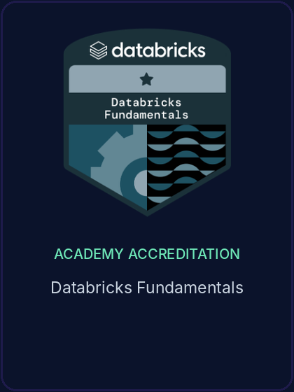
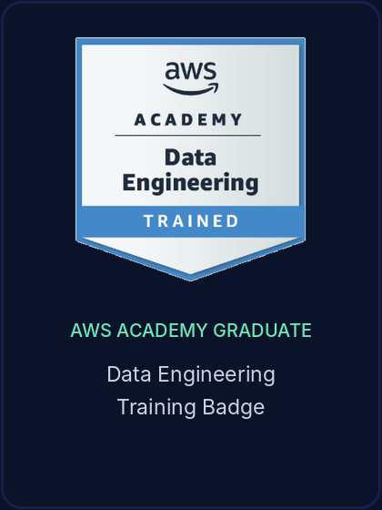

<div align="center">

</div>

<div align="center">

</div>

---

## About Me

I'm Joshuva Prabhakar Palicharla, a Software Engineer with an MS in Computer Science from Stevens Institute of Technology (May 2026). I build backend services, data pipelines, and AI applications that turn complex problems into practical software.

```python
class Joshuva:
    role      = "Software Engineer"
    education = "MS Computer Science, Stevens Institute of Technology"
    focus     = ["Backend & APIs", "Data Engineering", "Applied AI"]
    stack     = ["Python", "FastAPI", "SQL", "Spark", "Docker", "AWS | Azure | GCP"]
    results   = {"classification_accuracy": "94%", "r2": 87.38, "data_prep_time": "-30%"}
    open_to   = ["Software Engineer", "Backend", "Data Engineer", "Applied AI", "Data Analyst"]

    def ship(self):
        return "design -> implement -> test -> debug -> deploy"
```

| Area | What I do |
|---|---|
| **Backend & APIs** | Build applications and REST APIs with Python, FastAPI, and SQL, backed by automated testing and code reviews |
| **Generative & Agentic AI** | Develop LLM applications, RAG pipelines, and LangGraph agent workflows with tool calling, structured outputs, and evidence validation |
| **Search & Retrieval** | Combine vector search, embeddings, FAISS, BM25, hybrid retrieval, and cross-encoder reranking to improve document search |
| **Cloud & DevOps** | Package, test, and deploy with Docker, Git, GitHub Actions, and CI/CD across AWS, Azure, and GCP |
| **Data Engineering** | Build ETL pipelines with Spark, Databricks, and SQL, including project work processing 15M+ records |
| **Analytics & ML** | Apply machine learning, Power BI, and Tableau to find patterns and communicate insights |

Open to Software Engineering, Backend, Data Engineering, and Applied AI roles, as well as Data Analyst roles.

---

## Tech Stack

### Languages


### Backend & Web Development


### Generative AI & Agents


### Search & Retrieval


### Machine Learning & Deep Learning


### Data Engineering


### Databases


### Cloud Platforms


### DevOps & Engineering Tools


### Analytics & App Demos


---

## GitHub Stats

<div align="center">
  
  
</div>

<div align="center">
  
</div>

---

## Certifications

<div align="center">

<table>
<tr>
<td align="center" valign="top">
<details>
<summary>
<br>
<sub>Click to choose a credential</sub>
</summary>
<br>
<a href="https://learn.microsoft.com/api/credentials/share/en-us/JoshuvaPrabhakar-4435/3673A74756FD65EE?sharingId=A763E97263BC0958">Azure Data Engineer Associate &rarr;</a><br>
<a href="https://learn.microsoft.com/api/credentials/share/en-us/JoshuvaPrabhakar-4435/B52656250C7BA420?sharingId=A763E97263BC0958">Azure Data Scientist Associate &rarr;</a><br>
<a href="https://learn.microsoft.com/api/credentials/share/en-us/JoshuvaPrabhakar-4435/2CE820ADF78435DD?sharingId=A763E97263BC0958">Azure Developer Associate &rarr;</a>
</details>
</td>
<td align="center" valign="top">
<a href="https://www.credly.com/badges/4118ac45-62bd-4d5d-8802-17661d22295e/public_url"></a>
</td>
<td align="center" valign="top">
<a href="https://credentials.databricks.com/29e788d4-3ee6-48b6-acca-8e1d7a305c06"></a>
</td>
<td align="center" valign="top">
<a href="https://www.credly.com/badges/81a5eec8-172c-4b91-b091-254badc4a991/public_url"></a>
</td>
</tr>
</table>

</div>

---

<div align="center">

### Let's Connect & Build Something Amazing!

[](https://www.linkedin.com/in/joshuva-prabhakar/)
[](https://joshuva-portfolio.vercel.app/)

*"The best way to predict the future is to build it with AI."*

</div>
